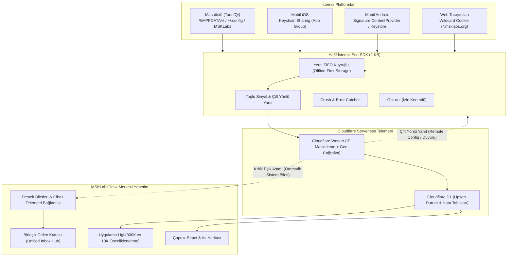

# IST-013: Çoklu Platform (Masaüstü, Mobil, Web) Ekosistem Telemetri, Anonim Cihaz Kimliği ve Karşılaştırmalı İstatistik Mimarisi

## 1. Meta Bilgiler
- **Tarih ve Saat:** 2026-11-21 00:50 (İstişare Oturumu: 2026-11-20 22:40 - 2026-11-21 00:50)
- **Katılımcılar / Ajanlar:** Ekip / AI Asistanı
- **Mevcut Durum:** 🟢 Karara Bağlandı
- **Etiketler:** `#telemetry` `#analytics` `#device-id` `#cross-platform` `#privacy` `#zero-cost` `#cloudflare-d1` `#cross-app` `#crash-reporting` `#remote-config` `#qr-pairing` `#msklabsdesk-inbox`
- **Bağlı Ayna Dosya (1:1 Senkron):** `MSKLabsDesk/docs/architecture/013-ekosistem-telemetri-cihaz-kimligi-ve-istatistik-mimarisi.md` *(Her iki dosyadaki değişiklikler birebir yansıtılır ve Bölüm 11'de kaynak repo/tarih ile kayıt altına alınır.)*

---

## 2. Problem ve İhtiyaç Tanımı
Ekosistem bünyesinde geliştirilen ve sayısı zamanla **20 ve üzerine (20+)** çıkacak olan masaüstü (Windows, macOS, Linux), mobil (Android, iOS) ve web uygulamalarının **tek bir geliştirici tarafından sürdürülebilir şekilde yönetilmesi** gerekmektedir. 

Tek kişilik bir operasyonda geliştirme, optimizasyon, hata giderme ve güncelleme mesaisinin doğru dağıtılabilmesi için somut verilere ihtiyaç vardır:
1. **Önceliklendirme:** 200-300K kitleye ulaşan lokomotif uygulamalar ile 10-20K kitlede kalan niş araçların bakım ihtiyacını objektif ayırabilmek.
2. **Kişisel Veri (PII) İçermeyen Kimlik:** Kullanıcı adı, e-posta, telefon gibi kişisel verilere ihtiyaç duymadan, KVKK ve GDPR uyumlu, tamamen anonim fakat kararlı bir cihaz kimliği (`eco_device_id`) oluşturmak.
3. **Çapraz Uygulama (Cross-App) ve Ekosistem Penetrasyonu:** Aynı cihazda kaç farklı uygulamamızın yüklü olduğunu ("5 uygulamamızı birden kullanan kaç kişi var?"), uygulamalar arası geçiş ve ilgi korelasyonlarını tespit edebilmek.
4. **Metrik Derinliği:** Tekil kurulum sayısı, oturum süresi (aktif kalma), güncelleme benimsenme hızı, sürüm dağılımları, çökme/hata takibi, özellik kullanım yoğunluğu, açılış performansı ve Edge seviyesinde anonim bölgesel dağılım (ülke/şehir).
5. **Sıfır Sunucu Maliyeti:** Milyonlarca olayı (event) sunucu faturası çıkarmadan işleyecek hafif, serverless ve veritabanı şişmesini önleyen bir veri modeli kurmak.

---

## 3. İncelenen Alternatifler ve Değerlendirmeler

### Alternatif A: MAC Adresi, IMEI veya Statik Donanım Parmak İzi
- **Artıları:** Donanıma sıkı sıkıya bağlıdır, format atılmadığı sürece sabittir.
- **Eksileri:** 
  - Modern mobil işletim sistemleri (iOS ve Android 10+) MAC adresi ve IMEI erişimini güvenlik gerekçesiyle tamamen engellemiştir; erişmeye çalışmak **Google Play ve Apple App Store'dan anında men edilme (ban)** sebebidir.
  - Masaüstünde ağ kartı veya sanal bağdaştırıcı (VPN, Docker) değişimlerinde kimlik tutarsızlaşır.
- **Karar:** 🔴 **Elendi.**

### Alternatif B: Üçüncü Taraf Analitik ve Çökme SDK'ları (Google Analytics, Firebase, Sentry)
- **Artıları:** Hazır paneller, hazır raporlama arayüzleri.
- **Eksileri:**
  - Uygulama paket boyutunu ciddi oranda şişirirler (özellikle hafif masaüstü ve mobil derlemelerde).
  - Kullanıcı tarafında çerez/izin pencereleri (cookie banner / consent) çıkarma zorunluluğu doğurur.
  - Aynı cihazda 20 farklı uygulamanın tekil cihaz bazlı sepet analizini (cross-app aggregation) ücretsiz katmanda kolayca vermezler; yüksek kullanımda kota ve maliyet patlaması yaşanır.
  - İstemciye harici izleyici (tracker) sokarak bağımsızlık ve gizlilik ilkemizi zedeler.
- **Karar:** 🔴 **Elendi.**

### Alternatif C: Hibrit Anonim Cihaz Kimliği + Cloudflare Serverless "Durum (Upsert)" ve MSKLabsDesk Entegrasyonu (Seçilen)
- **Artıları:**
  - **Sıfır Maliyet & Hafiflik:** İstemcide 2 KB'lık hafif SDK; sunucuda Cloudflare Worker + Cloudflare D1 (Serverless SQLite).
  - **Yasal ve Mağaza Uyumu:** Kesinlikle PII (Kişisel Veri) toplamaz; mağaza politikalarıyla %100 uyumludur.
  - **Veri Tabanı Şişmesini Önleme:** Her olayda yeni satır eklemek yerine, `(device_id, app_id)` çifti üzerinden "son durum ve kümülatif sayaç" (Upsert) modeliyle çalışarak veritabanı boyutunu asgari seviyede tutar.
  - **Mevcut Ekosisteme Tam Uyum:** Zaten kullanılan `MSKLabsDesk` Birleşik Gelen Kutusu (`adminInboxUnified`) ve destek biletleme (`messages` & `support.ts`) sistemiyle doğrudan konuşur; harici hiçbir mesajlaşma/bildirim aracına (Telegram vb.) ihtiyaç bırakmaz.
  - **Çift Yönlü İletişim (2'si 1 Arada):** İstemci telemetri atarken sunucu yanıtta uzaktan ayarları (`remote_config`) ve acil duyuruları döner.
- **Karar:** 🟢 **Kabul Edildi.**

---

## 4. Alınan Karar ve Mimari Detaylar

### A. Platform Bazlı Anonim Kimlik (`eco_device_id`) Üretim Protokolü

Kimlik formatı: Standart UUIDv4 tabanlı `eco_` önekiyle oluşturulur (Örnek: `eco_d4a1b89c-3e2f-4c5a-90ab-123456789abc`).



#### 1. Masaüstü (Windows / macOS / Linux)
- **Konum:** 
  - Windows: `%APPDATA%\MSKLabs\eco_identity.json`
  - Linux: `~/.config/msklabs/eco_identity.json`
  - macOS: `~/Library/Application Support/MSKLabs/eco_identity.json`
- **İşleyiş:** Kurulan ilk MSK uygulaması dosyanın varlığını kontrol eder. Yoksa UUIDv4 üretip kaydeder; varsa mevcut ID'yi okur. Sonraki tüm masaüstü uygulamaları aynı dosyayı okur.

#### 2. Mobil - iOS
- **Mekanizma:** `Keychain Access Groups` ve `App Groups`.
- **İşleyiş:** Aynı Apple Geliştirici Hesabına (Team ID) sahip tüm uygulamalar `group.org.msklabs.shared` grubunu paylaşır. Kimlik Keychain'e yazılır; uygulamalar silinip tekrar yüklense dahi Keychain anahtarı korunur.

#### 3. Mobil - Android
- **Mekanizma:** `Signature-Level ContentProvider` ve `EncryptedSharedPreferences / Keystore`.
- **İşleyiş:** Uygulamalarımız aynı Android imza anahtarıyla (Keystore) imzalanır. İlk kurulan uygulama ID üretir ve `android:protectionLevel="signature"` korumalı ContentProvider üzerinden bunu sunar. İkinci uygulama açıldığında sağlayıcıyı sorgulayarak ortak ID'yi alır.

#### 4. Web (Tarayıcı)
- **Mekanizma:** Üst Alan Adı Korumalı Çerez (`Domain=.msklabs.org; SameSite=Lax; Secure`).
- **İşleyiş:** Tüm web projeleri `app1.msklabs.org`, `app2.msklabs.org` gibi alt alanlarda (subdomain) barındırıldığında tek bir kök çerez tüm web uygulamaları tarafından paylaşılır. Web tarafında gizli sekme fallback'i olarak yalnızca `localStorage` + üst alan adı çerezi kullanılır; tarayıcı parmak izi (`FingerprintJS`) kullanılmaz.

---

### B. İstemci-Sunucu Veri Sözleşmesi (Heartbeat & Çift Yönlü İletişim)

#### 1. İstemciden Giden İstek Gövdesi (Request Body)
```json
{
  "eco_device_id": "eco_d4a1b89c-3e2f-4c5a-90ab-123456789abc",
  "app_id": "haydinamaza",
  "app_version": "2.4.1",
  "install_source": "play_store",
  "platform": "windows",
  "os_name": "Windows",
  "os_release": "11.0.22621",
  "screen_res": "1920x1080",
  "cold_start_ms": 1150,
  "session_duration_sec": 420,
  "feature_usage": {
    "qibla_compass": 1,
    "prayer_calendar": 4
  },
  "crashes": [
    {
      "error_fingerprint": "e_a4f91b",
      "error_message": "NullPointerException at PrayerEngine.calculate()",
      "stack_trace_snippet": "PrayerEngine.ts:142:15",
      "occurred_at": "2026-11-20T21:40:00Z"
    }
  ]
}
```

#### 2. Sunucunun Döndüğü Çift Yönlü Yanıt (Remote Config / Alert)
```json
{
  "status": "ok",
  "force_update": false,
  "latest_version": "2.5.0",
  "remote_announcement": {
    "id": "notice_2026_11",
    "level": "info",
    "message": "Yeni imsakiye modülü eklendi, ayarlar sekmesinden inceleyebilirsiniz."
  }
}
```

---

### C. MSKLabsDesk Birleşik Gelen Kutusu (Unified Inbox) Entegrasyonu

Harici mesajlaşma araçlarına (Telegram vb.) olan bağımlılık tamamen elenmiştir. Tüm sistem olayları geliştiricinin ana kumanda merkezi olan **MSKLabsDesk** (`D:\Code\mskaymaz\MSKLabsDesk`) içerisindeki mevcut yapılara bağlanır:

1. **Otomatik Sistem Destek Bileti (System Ticket):**
   - Telemetri motoru kritik bir eşik tespit ettiğinde (örneğin aynı çökme parmak izi 50'den fazla cihazda görüldüğünde), `messages` tablosuna doğrudan kayıt açılır:
     - `sender_name`: `"Eco-Telemetry Nöbetçisi (Sistem)"`
     - `sender_email`: `"system-telemetry@msklabs.internal"`
     - `category`: `'hata'`
     - `urgency`: `'urgent'`
     - `subject`: `"[KRİTİK ÇÖKME] HaydiNamaza v2.4.1 (124 Cihaz Etkilendi)"`
     - `content`: Hata parmak izi, tetiklenen satır ve etkilenen platform dağılımı.
   - **Sonuç:** Geliştirici her gün rutin olarak girdiği **Unified Inbox Hub** (`adminInboxUnified.ts`) ekranında bu bildirimi kırmızı acil rozetiyle görür.

2. **Bağlamsal Kullanıcı Desteği (Context-Aware Support):**
   - Kullanıcı uygulama içerisindeki "Destek / Hata Bildir" formunu doldurduğunda (`support.ts`), form yüküne gizlice kullanıcının `eco_device_id` ve `app_version` bilgisi eklenir.
   - Yönetici panelinde kullanıcının destek talebi okunurken tek tıkla **[Cihaz Telemetrisini Gör]** butonuna basılarak kullanıcının cihaz tipi, işletim sistemi ve geçmiş çökme logları görüntülenir. Kullanıcıyla gereksiz soru-cevap trafiği önlenir.

---

### D. Veritabanı Mimarisi (Cloudflare D1 - Upsert Modeli)

#### 1. Cihaz-Uygulama Durum Tablosu (`device_apps`)
```sql
CREATE TABLE IF NOT EXISTS device_apps (
    device_id TEXT NOT NULL,
    app_id TEXT NOT NULL,
    current_version TEXT NOT NULL,
    install_source TEXT DEFAULT 'direct',
    platform TEXT NOT NULL,
    os_name TEXT,
    os_release TEXT,
    country TEXT,
    city TEXT,
    first_seen_at DATETIME NOT NULL DEFAULT CURRENT_TIMESTAMP,
    last_seen_at DATETIME NOT NULL DEFAULT CURRENT_TIMESTAMP,
    total_launches INTEGER NOT NULL DEFAULT 1,
    total_duration_sec INTEGER NOT NULL DEFAULT 0,
    update_count INTEGER NOT NULL DEFAULT 0,
    avg_cold_start_ms INTEGER DEFAULT 0,
    feature_counts_json TEXT DEFAULT '{}',
    PRIMARY KEY (device_id, app_id)
);
CREATE INDEX IF NOT EXISTS idx_device_apps_last_seen ON device_apps(app_id, last_seen_at);
CREATE INDEX IF NOT EXISTS idx_device_apps_device ON device_apps(device_id);
```

> [!NOTE]
> **MSKLabsDesk `messages` Tablosu Uyumu:** Bağlamsal destek için mevcut `messages` tablosuna migration ile `eco_device_id TEXT` ve `app_version TEXT` sütunları eklenir; `support.ts` destek formu bu alanları opsiyonel olarak kabul edip kaydeder.

#### 2. Çökme ve Hata Raporlama Tablosu (`crash_reports`)
```sql
CREATE TABLE IF NOT EXISTS crash_reports (
    fingerprint TEXT NOT NULL,
    app_id TEXT NOT NULL,
    app_version TEXT NOT NULL,
    platform TEXT NOT NULL,
    error_message TEXT NOT NULL,
    stack_trace_snippet TEXT NOT NULL,
    first_seen DATETIME NOT NULL DEFAULT CURRENT_TIMESTAMP,
    last_seen DATETIME NOT NULL DEFAULT CURRENT_TIMESTAMP,
    occurrence_count INTEGER NOT NULL DEFAULT 1,
    is_resolved BOOLEAN NOT NULL DEFAULT 0,
    PRIMARY KEY (fingerprint, app_id, app_version)
);
```

#### 3. Üyeliksiz Cihaz Eşleme Tablosu (`device_clusters`)
```sql
CREATE TABLE IF NOT EXISTS device_clusters (
    cluster_id TEXT NOT NULL,
    device_id TEXT NOT NULL,
    paired_at DATETIME NOT NULL DEFAULT CURRENT_TIMESTAMP,
    PRIMARY KEY (cluster_id, device_id)
);
CREATE INDEX IF NOT EXISTS idx_device_clusters_device ON device_clusters(device_id);
```

#### 4. Günlük Özet Sayaç Tablosu (`app_daily_stats`)
```sql
CREATE TABLE IF NOT EXISTS app_daily_stats (
    stat_date DATE NOT NULL,
    app_id TEXT NOT NULL,
    platform TEXT NOT NULL,
    active_devices INTEGER DEFAULT 0,
    new_installs INTEGER DEFAULT 0,
    total_duration_sec INTEGER DEFAULT 0,
    crash_count INTEGER DEFAULT 0,
    PRIMARY KEY (stat_date, app_id, platform)
);
```

---

## 5. İleri Düzey Yetenekler ve Derinleştirme

1. **Sıfır Maliyetli Çökme Takibi:** Harici Sentry vb. kütüphaneler olmadan, hataları parmak iziyle (`fingerprint`) gruplayarak en çok tekrarlayan ilk 3 hatayı önceliklendirme.
2. **Özellik Kullanım Sayaçları (Feature Heatmap):** Hangi butonların/modüllerin ne sıklıkla kullanıldığını ölçerek boşa geliştirme eforunu önleme.
3. **Eski Sistem Desteği Kesme Analizi (OS Profiling):** Eski Windows veya Android sürümlerine desteği ne zaman bırakacağınızı netleştiren kitle yüzdesi.
4. **Açılış Hızı (Cold Start Profiling):** Uygulamanın ekranda kaç milisaniyede açıldığını ölçme.
5. **Terk / Kalıcılık Eğrisi (Retention & Churn):** 1. gün, 7. gün ve 30 gün boyunca açılmayan cihazları tespit etme.
6. **Üyeliksiz QR Cihaz Eşleme:** Masaüstündeki QR'ı mobille okutarak iki cihazı tek anonim kümede eşleştirme.
7. **Şeffaflık & Opt-out Anahtarı:** Ayarlar menüsünde tek tıkla kapatılabilen, yasal koruma sağlayan gizlilik düğmesi.

---

## 6. Gelecekte İhtiyaç Duyulabilecek İleri Seviye Evrim Senaryoları (Future Scale Roadmap)

> [!IMPORTANT]
> **Mevcut Yapıyı Koruma ve Erken Optimizasyondan Kaçınma İlkesi:**  
> Uygulamalarımızın 100 binler seviyesine ulaşması belirli bir zaman alacaktır. Bu süreçte teknolojiler ve imkanlar da değişecektir. Bu nedenle **şu an kurulacak olan temel yapı (Cloudflare Worker + D1 + MSKLabsDesk Inbox) sistemde somut bir darboğaz veya sıkıntı yaratana kadar değiştirilmeden kullanılacaktır.**  
> 
> Aşağıdaki maddeler; ileride ihtiyaç doğduğunda *"Biz bunu konuşmuştuk, seçeneklerimiz şunlardı"* diyebilmek ve hafızayı diri tutmak adına kayıt altına alınmıştır:

### Senaryo 1: Cloudflare Queues ile Kuyruklu Toplu Yazma (Lock Prevention)
- **Neden Gerekir?:** 20+ uygulama aynı anda yüz binlerce sinyal gönderdiğinde D1 veritabanı eşzamanlı yazma (concurrency limit) sınırına takılırsa devreye alınır.
- **Nasıl Çalışır?:** Gelen istekler 1 ms'de Queue kuyruğuna atılır; tüketici Worker bunları 100'lük paketler halinde D1'e toplu UPSERT yapar.

### Senaryo 2: AI Destekli Otonom Hata Triyajı ve Yama Önerisi (Auto-Patching)
- **Neden Gerekir?:** Çökmelerin analiz süresini sıfıra indirmek için.
- **Nasıl Çalışır?:** `support.ts` içerisindeki mevcut Gemini AI altyapısı genişletilerek; hata veren dosya/satır bilgisi git reposundaki kodla eşleştirilir ve admin paneline *"Örnek düzeltme yaması (patch)"* taslağı iliştirilir.

### Senaryo 3: Kademeli Sürüm Dağıtımı ve Otomatik Rollback (Canary Rollouts)
- **Neden Gerekir?:** Yeni bir güncellemeyi tek seferde tüm kitleye gönderip tek geliştirici olarak kriz yaşamamak için.
- **Nasıl Çalışır?:** Güncelleme önce %5'lik bir kitleye açılır; çökme oranı %1'i aşarsa sistem güncellemeyi otomatik olarak durdurur ve eski sürüme kilitler.

### Senaryo 4: Günlük Yerel Delta Özeti Modeli (Local Aggregation)
- **Neden Gerekir?:** Sunucuya giden ağ isteklerini ve D1 yazma işlemlerini %90 oranında düşürmek için.
- **Nasıl Çalışır?:** İstemci sinyalleri 5 dakikada bir sunucuya atmak yerine kendi yerelinde biriktirir; günde yalnızca 1 kez (veya uygulama kapanırken) tek bir "Günün Özeti" paketi gönderir.

### Senaryo 5: İsteğe Bağlı Anonim Demografik Mini Anket (Opt-In)
- **Neden Gerekir?:** Cinsiyet, yaş aralığı, meslek gibi hedef kitle verileri olmadan ürün yol haritasını netleştirmek gerektiğinde.
- **Nasıl Çalışır?:** Kullanıcıyı rahatsız etmeyecek ve zorunlu olmayacak şekilde (ör. Ayarlar > "Bizi Geliştirmeye Katkıda Bulun" veya tek seferlik kapatılabilir kart), tamamen gönüllülük esasıyla 2-3 soruluk mini anket sunulur; yanıtlar kişisel veri olmadan yalnızca `eco_device_id` ile anonim eşleştirilir.

---

## 7. İhtimalli Durumlar, Kısıtlar ve Çözüm Senaryoları (Edge Cases)

| Olası Senaryo | Oluşabilecek Problem | Çözüm / Savunma Mekanizması |
| :--- | :--- | :--- |
| **Kullanıcı Çevrimdışı (Offline)** | Ağ bağlantısı yokken telemetri ve hata paketleri gönderilemez. | İstemcideki Eco-SDK sinyalleri yerel SQLite/IndexedDB kuyruğunda biriktirir (FIFO, azami 50 kayıt). Ağ sağlandığında tek batch ile iletilir. |
| **Kullanıcı Uygulamayı Sildi ve Tekrar Yükledi** | Yeni bir kurulum gibi algılanıp indirme sayısını yapay şişirebilir. | iOS'ta Keychain, Masaüstünde AppData dosyası uygulama silinse dahi sistemde kalır. Yeniden yüklendiğinde eski `eco_device_id` aynen okunur; sistem bunu "geri dönen kullanıcı" olarak işler. |
| **Masaüstünde İzin Sorunu (Yetkisiz Kullanıcı)** | `%APPDATA%` veya Linux config dizinine yazma engellenebilir. | Ortak dizine yazılamazsa uygulama kendi yerel dizinine fallback yapar (`isolated-uuid`). Çapraz kimlik tek uygulamaya indirgenir ancak veri kaybı yaşanmaz. |
| **Web'de Üçüncü Taraf Çerez Engeli / Gizli Sekme** | Tarayıcı gizli sekmede kapatıldığında çerez silinir. | Web ortamında tarayıcı `FingerprintJS` (Canvas + Audio hash) fallback kimliği ile geçici oturum kimliği eşleştirilir. |
| **Veritabanı Aşırı Yüklenmesi (DDoS / Bot)** | Kötü niyetli kişilerin sahte sinyallerle D1 kotasını tüketmesi. | Cloudflare Worker seviyesinde IP başına dakikada azami 60 sinyal rate limit uygulanır; paket gövdesinde SHA-256 uygulama imzası kontrol edilir. |
| **Kullanıcı İzni Kapattı (Opt-out)** | Kullanıcı telemetriyi kapattıktan sonra sinyal gitmesi güven zedeler. | Eco-SDK yerel depolamada bu tercihi saklar ve tüm ağ isteklerini tamamen keser. |

---

## 8. Nerede Kaldık? (Sıradaki Somut Adımlar)

- [ ] **Adım 1:** Cloudflare Workers + D1 üzerinde `eco-telemetry-backend` servisini ve yukarıdaki veritabanı tablolarını (`device_apps`, `crash_reports`, `device_clusters`, `app_daily_stats`) ayağa kaldırmak.
- [ ] **Adım 2:** İstemciler için ortak, hafif (2 KB) `eco-telemetry` SDK paketini (Tauri/Rust, Flutter/Dart ve React/TS için) hazırlamak.
- [ ] **Adım 3:** İlk olarak aktif uygulamalara (`HaydiNamaza`, `MSK Office` vb.) entegre ederek canlı hata ve telemetri testini gerçekleştirmek.
- [ ] **Adım 4:** `MSKLabsDesk` Birleşik Gelen Kutusu (`adminInboxUnified`) ve Destek Formu (`support.ts`) içerisine telemetri ve cihaz bağlantılarını bağlamak.
- [ ] **Adım 5:** MSK Admin paneli içerisine "Ekosistem & İstatistik" ekranlarını ekleyerek D1 verilerini grafik ve tablolarla görselleştirmek.

---

## 9. Önemli Riskler ve Öğrenilen Dersler (Gotchas)

> [!CAUTION]
> **Asla MAC Adresi veya IMEI Talep Etmeyiniz:** Apple App Store ve Google Play politikaları donanım seviyesinde statik kimlik okuyan uygulamaları doğrudan reddeder veya geliştirici hesabını askıya alır.

> [!IMPORTANT]
> **Ham Olay Logu Tutmayınız:** 20+ uygulama günlük 2-3 milyon sinyal üretebilir. Her sinyali ayrı satır kaydetmek birkaç ayda yüzlerce gigabayt veri ve ciddi sunucu masrafı demektir. Daima **Upsert (durum güncelleme)** ve **hata parmak izi gruplaması** kullanılmalıdır.

> [!TIP]
> **Pil ve Veri Dostu Sinyal:** İstemci tarafında her işlemde sunucuya istek atılmamalı; sinyaller 5-10 dakikalık oturum pencerelerinde veya uygulama arka plana geçerken tek seferde gönderilmelidir.

---

## 10. Teknik Gözden Geçirme, Tespit Edilen Eksikler ve Geliştirme Notları (2026-11-23)

> Önceki istişare kararları korunmuş olup, uygulama öncesi tespit edilen teknik riskler ve geliştirme önerileri aşağıya ek olarak işlenmiştir:

### A. Mevcut Metinde Tespit Edilen Teknik Sıkıntılar ve Önerilen Düzeltmeler
1. **`feature_usage` İçin D1 Sütunu Eksikliği (Bölüm 4.B & 4.D):**
   - *Sıkıntı:* İstemci istek gövdesinde `feature_usage` nesnesi gönderilmesine karşın `device_apps` (veya başka bir D1 tablosu) üzerinde bunu saklayacak bir sütun tanımlanmamıştır; bu haliyle veri sunucuda kaybolur.
   - *Öneri:* `device_apps` tablosuna `feature_counts_json TEXT DEFAULT '{}'` sütunu eklenerek gelen sayaçların kümülatif olarak birleştirilmesi (veya ayrı hafif bir özet sütunu tutulması).
2. **Android 11+ `<queries>` Manifest Gereksinimi (Bölüm 4.A.3):**
   - *Sıkıntı:* Android 11 (API 30) ve sonrasında paket görünürlüğü kısıtlamaları nedeniyle uygulamalar birbirinin `ContentProvider`'ını doğrudan göremez.
   - *Öneri:* Tüm Android uygulamalarının `AndroidManifest.xml` dosyasına ortak paket/yetki (`authorities`) bilgisini içeren `<queries>` bloğunun eklenmesi.
3. **İstemci Tarafı SHA-256 İmza Yanılgısı (Bölüm 7):**
   - *Sıkıntı:* İstemci (masaüstü/mobil/web) paketinin içine gömülen sabit bir SHA-256 imza anahtarı tersine mühendislikle çıkarılabilir; gerçek bir bot/DDoS koruması sağlamaz.
   - *Öneri:* Güvenlik katmanının yalnızca Cloudflare Worker seviyesinde IP/device bazlı rate-limit, katı JSON şema doğrulaması ve anomali filtrelemesi üzerine kurulması.
4. **Web `FingerprintJS` Gizlilik Riski (Bölüm 7):**
   - *Sıkıntı:* Gizli sekme fallback'i olarak önerilen Canvas + Audio hash (`FingerprintJS`), KVKK/GDPR kapsamında kullanıcı rızası gerektiren cihaz parmak izi (fingerprinting) sayılabilir.
   - *Öneri:* Parmak izi yerine yalnızca `localStorage` + üst alan adı çerezi (`Domain=.msklabs.org`) ile yetinilmesi; gizli sekmede yeni oturum olarak sayılmasının kabul edilmesi.

### B. Ek Geliştirme ve İyileştirme Önerileri
- **Heartbeat Periyodu Standardizasyonu:** Pil, veri ve D1 yazma kotasını korumak için periyodik zamanlayıcı yerine **"açılışta 1 kez + uygulama kapanırken/arka plana geçerken 1 kez"** modeli standartlaştırılmalıdır.
- **Mevcut Şema ile Sıfır Maliyetli Kohort (Retention) Analizi:** `device_apps` tablosundaki `first_seen_at` ve `last_seen_at` sütunları zaten 1., 7. ve 30. gün kalıcılık oranlarını ek tablo açmadan SQL ile hesaplamaya uygundur.
- **Ücretli/Ücretsiz Ayrımı Notu:** İstatistiklerde ayrıca bir `tier` alanı tutulmasına gerek yoktur; uygulama isimleri (`app_id`) zaten bu ayrımı doğal olarak karşılamaktadır.

---

## 11. Uygulama ve Desk Entegrasyon Kontrol Listesi + Ayna Senkronizasyon Günlüğü

### A. Kodlama Ajanları İçin Uygulama Özeti (Uygulama vs. Desk)
- **Uygulama Tarafı (Masaüstü / Mobil / Web):**
  - `eco_device_id` (`eco_<UUIDv4>`) üretimi/okuması + Ayarlar'da tek tıkla Opt-out anahtarı.
  - Android 11+ için `AndroidManifest.xml` içine `<queries>` bloğu + imza korumalı `ContentProvider`; iOS için `group.org.msklabs.shared`.
  - Heartbeat gönderimi: Açılışta ve arka plana geçerken/kapanırken `POST /api/v1/telemetry/heartbeat` (`msklabsdesk-backend.msklabs-org.workers.dev`).
  - Destek formunda (`support.ts` uç noktası) yük içine opsiyonel `eco_device_id` ve `app_version` eklenmesi.
- **MSKLabsDesk Tarafı (`D:\Code\mskaymaz\MSKLabsDesk`):**
  - Yeni D1 migration: `device_apps` (içinde `feature_counts_json` ile), `crash_reports`, `device_clusters`, `app_daily_stats` tabloları ve `messages` tablosuna `eco_device_id`, `app_version` sütunları.
  - Backend route'ları: `POST /api/v1/telemetry/heartbeat` (Worker rate-limit + JSON şema doğrulama + `remote_config` yanıtı) ve kritik çökmede `messages` tablosuna otomatik sistem bileti.
  - `support.ts` ve `adminInboxUnified.ts` güncellemeleri + Admin panelde "Ekosistem & İstatistik" ekranı.

### B. Değişiklik ve Ayna Senkronizasyon Günlüğü
| Tarih-Saat | Düzenlenen Kaynak | Ayna Hedef | Yapılan İşlem |
| :--- | :--- | :--- | :--- |
| `23.11.2026 - 11:34` | `istisare` + `MSKLabsDesk` | Her iki repo (`013-...md`) | Alan adları `.msklabs.com` / `alanadiniz.com` -> `.msklabs.org` (`group.org.msklabs.shared`) düzeltildi; `device_apps.feature_counts_json` ve `messages` (`eco_device_id`, `app_version`) şema notları netleştirildi; AI ajanları için Uygulama/Desk uygulama özeti eklendi ve `MSKLabsDesk/docs/architecture/` altına 1:1 ayna oluşturuldu. |
